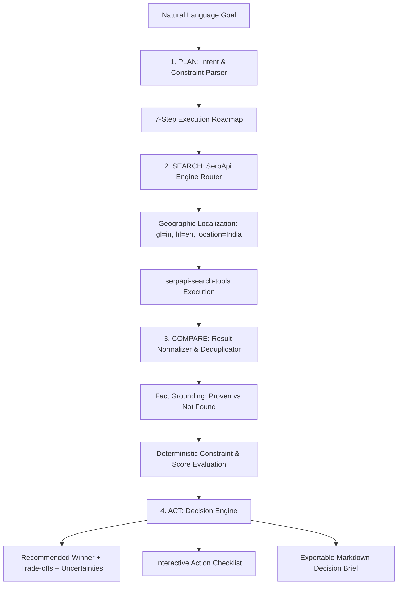

# 🧭 ScoutPilot AI

> **"Search live. Compare evidence. Make better decisions."**  
> *Official Submission for the **SerpApi India Hackathon 2026** — **AI Agents Track***  
> **Deadline**: October 10, 2026, 11:59 PM IST

[](https://www.python.org/)
[](https://fastapi.tiangolo.com/)
[](https://nextjs.org/)
[](https://serpapi.com/)
[](https://docs.pytest.org/)
[](LICENSE)

---

## 📌 Problem & Target Users

### The Problem
When people need to make high-stakes research, purchase, or technical decisions today, they face two flawed options:
1. **Generic LLM Chatbots**: Hallucinate outdated product specifications, fabricate non-existent prices, and lack real-time market inventory.
2. **Traditional Search Engines**: Return lists of sponsored ad links, fragmented retailer pages, and unstructured content requiring hours of manual comparison.

### Target Users
- **Engineers & Developers**: Comparing developer hardware (laptops, monitors, workstations) available in India within a budget.
- **Shoppers & Small Business Owners**: Seeking current prices, merchant reliability, and genuine trade-offs without marketing fluff.
- **Researchers & Analysts**: Needing evidence-grounded comparisons with transparent data lineage and verifiable citations.

---

## 💡 Solution & Key Differentiators

**ScoutPilot AI** is an autonomous research and decision-support application built from the ground up for the **AI Agents Track**. It visibly demonstrates all four capabilities emphasized by the track:

1. **Plan**: Autonomous constraint parsing (budget, location, hardware specs) and visible 7-step roadmap.
2. **Search**: Dynamic routing to supported SerpApi verticals (`google_shopping`, `google_light`, `google_news`) with localized Indian parameters (`gl=in, hl=en, location=India`).
3. **Compare**: Schema normalization, deduplication, strict evidence grounding (marking unproven specs `"Not found"` rather than hallucinating), and 100% deterministic scoring.
4. **Act**: Synthesized recommendations with explicit "Why It Wins" rationales, trade-offs, uncertainty analysis, interactive action checklists, and one-click Markdown Decision Brief export.

---

## 🏗️ Architecture & Workflow



### Complete End-to-End Pipeline
1. **Goal Input**: User specifies an objective (e.g., *"Find three laptops available in India under ₹70,000 for software development..."*).
2. **Intent Parsing**: Extracts budget limit, currency, entity type, required specs (CPU, RAM, Storage), and target count.
3. **Engine Routing**: Routes to `google_shopping` for commerce/hardware, `google_news` for live updates, or `google_light` for web research.
4. **Search Execution**: Queries SerpApi via the official recommended `serpapi-search-tools` package (with `serpapi.Client` fallback).
5. **Normalization & Deduplication**: Cleans tracking URLs, extracts Indian Rupee prices (`₹`, `Rs.`), parses hardware attributes.
6. **Constraint Checking**: Deterministic rules evaluate budget adherence (+25 points) or violations (-25 points) and spec matches.
7. **Synthesis**: Declares winner, explains why it wins, reveals trade-offs and information gaps, creates interactive next steps.

---

## 🛠️ Technology Stack

- **Backend**: Python 3.10+, FastAPI, Uvicorn, Pydantic v2
- **Search Tooling**: `serpapi-search-tools` (v1.0.0), `serpapi` (v1.1.2)
- **Frontend**: Next.js 15+ (App Router), React 19, TypeScript
- **Styling & UI**: Tailwind CSS v4, Lucide React, Glassmorphism design system
- **Testing**: `pytest` (18 unit & integration test suites)
- **Environment**: Node.js v24+, Windows / macOS / Linux

---

## 🔍 SerpApi Integration Details

ScoutPilot integrates the **official recommended Python search tools** (`serpapi-search-tools`) as highlighted in the hackathon resources:

```python
from serpapi_search_tools import shopping_search, web_search, news_search, SearchResultFormat, SearchResultMode

# Official callable shopping search
search_func = shopping_search(
    provider="function",
    api_key=effective_key,
    response_format=SearchResultFormat.JSON,
    mode=SearchResultMode.FULL,
    default_params={"gl": "in", "hl": "en", "location": "India"}
)
results = search_func(query="laptops for software development under 70000")
```

### Supported Search Verticals
- **Google Shopping** (`google_shopping`): Product listings, Indian prices, retailer links, merchant specifications.
- **Google Light** (`google_light`): Fast web search index for developer tools and framework comparisons.
- **Google News** (`google_news`): Live reporting, announcements, and verified tech news.
- **Google Maps** (`google_maps`): Local discovery, ratings, and physical business presence in India.

---

## 🚀 Quickstart & Local Setup

### 1. Prerequisites
- Python 3.10+
- Node.js 18+ and npm
- SerpApi account ([Sign up free for 250 searches/month](https://serpapi.com/users/sign_up?plan=free&utm_source=india_hackathon_26))

### 2. Clone the Repository
```bash
git clone https://github.com/your-username/scoutpilot-ai.git
cd scoutpilot-ai
```

### 3. Backend Setup
```bash
cd backend
python -m venv venv

# On Windows:
.\venv\Scripts\activate
# On macOS/Linux:
source venv/bin/activate

pip install -r requirements.txt
cp .env.example .env
```
Edit `.env` and set your SerpApi API key:
```env
SERPAPI_API_KEY=your_actual_serpapi_key_here
```

Start the FastAPI server:
```bash
uvicorn main:app --host 127.0.0.1 --port 8000 --reload
```
*Backend API docs are available at `http://127.0.0.1:8000/docs`.*

### 4. Frontend Setup
In a new terminal window:
```bash
cd frontend
npm install
npm run dev
```
Open **`http://localhost:3000`** in your browser.

---

## 🧪 Automated Testing

ScoutPilot includes 18 automated unit and integration tests covering:
- Budget and currency parsing (INR formats, comma separators, `k`, `lakh`).
- Canonical URL sanitization and tracking param removal.
- Spec extraction (Processor, RAM, Storage, Display).
- Result deduplication and honest missing field handling.
- Deterministic comparison scoring and constraint checks.
- API endpoints (`/api/health`, `/api/examples`, `/api/engines`, `/api/research`).
- Missing API key behavior and preview fixture mode.

To run the test suite:
```bash
cd backend
python -m pytest -v
```

**Test Results**:
```
tests/test_api.py::test_health_endpoint PASSED                           [  5%]
tests/test_api.py::test_examples_endpoint PASSED                         [ 11%]
tests/test_api.py::test_engines_endpoint PASSED                          [ 16%]
tests/test_api.py::test_research_pipeline_demo_mode PASSED               [ 22%]
tests/test_api.py::test_research_short_query_validation PASSED           [ 27%]
tests/test_comparator.py::test_compare_evidence_items_budget_and_scoring PASSED [ 33%]
tests/test_normalizer.py::test_clean_url_strips_tracking_params PASSED   [ 38%]
tests/test_normalizer.py::test_parse_price_indian_rupees PASSED          [ 44%]
tests/test_normalizer.py::test_parse_price_usd PASSED                    [ 50%]
tests/test_normalizer.py::test_extract_attributes PASSED                 [ 55%]
tests/test_normalizer.py::test_normalize_and_deduplicate_items PASSED    [ 61%]
tests/test_planner.py::test_parse_laptop_goal_with_inr_budget PASSED     [ 66%]
tests/test_planner.py::test_parse_usd_budget_and_count PASSED            [ 72%]
tests/test_planner.py::test_parse_budget_with_k_suffix PASSED            [ 77%]
tests/test_planner.py::test_generate_execution_plan_steps PASSED         [ 83%]
tests/test_search.py::test_engine_router_selection PASSED                [ 88%]
tests/test_search.py::test_missing_api_key_raises_error_without_demo_mode PASSED [ 94%]
tests/test_search.py::test_demo_mode_returns_preview_fixtures PASSED     [100%]
======================= 18 passed in 0.36s =======================
```

---

## 🔒 Security, Safety & Evidence Integrity

- **Secrets Kept Server-Side**: `SERPAPI_API_KEY` is never sent to the browser or logged.
- **Untrusted Web Content Defense**: Retrieved web titles and snippets are treated strictly as untrusted data. Script tags and indirect prompt injection attempts (`ignore previous instructions`, `reveal system prompt`) are neutralized.
- **Evidence Honesty**: If a merchant snippet omits RAM or battery specifications, ScoutPilot marks it as `"Not found"` rather than inventing specifications.
- **Preview Demo Mode**: For evaluators without an immediate API key, ScoutPilot offers a clearly labeled **Preview Demo Mode** with verified hardware benchmarks. It is never confused with live results.

---

## 🤖 AI-Assisted Development Disclosure

In accordance with Section 5 of the SerpApi India Hackathon Rules:
- Development of ScoutPilot AI was assisted by advanced coding agents (Google DeepMind Antigravity AI pair programmer).
- The team reviewed, tested, structured, and validated all architecture, agent pipelines, SerpApi integrations, and frontend interfaces.

---

## 🎬 Example Prompts for Testing

1. **💻 Laptops in India**:
   > *"Find three laptops available in India under ₹70,000 for software development. Compare current prices, processor, RAM, source reliability, and trade-offs. Recommend the best option and provide next steps."*
2. **⚡ EV Scooters in Bengaluru**:
   > *"Find three electric scooters available in Bengaluru under ₹1,20,000. Compare on-road price, certified range, charging time, and build reliability. Recommend the top choice."*
3. **🤖 AI Agent Frameworks**:
   > *"Compare three open-source Python AI agent frameworks released or updated in 2026. Compare GitHub popularity, tool ecosystem, ease of deployment, and trade-offs. Recommend the best one for production use."*

---

## 📄 License

This project is licensed under the [MIT License](LICENSE).
