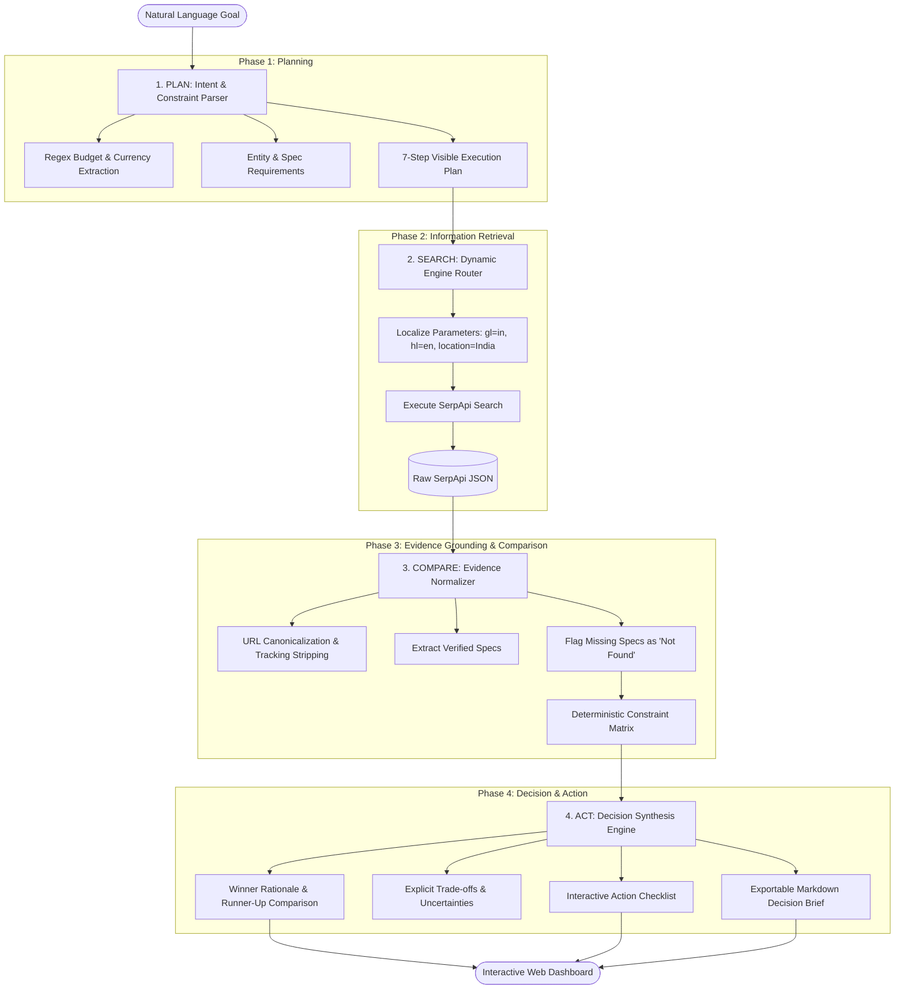

# ScoutPilot AI

> **Autonomous research and decision-support agent powered by SerpApi.**  
> _Search live. Compare evidence. Make better decisions._

[](https://www.python.org/)
[](https://fastapi.tiangolo.com/)
[](https://nextjs.org/)
[](https://www.typescriptlang.org/)
[](https://serpapi.com/)
[](https://docs.pytest.org/)
[](LICENSE)

---

## Summary

**ScoutPilot AI** is an autonomous research and decision-support system built for the **SerpApi India Hackathon 2026 (AI Agents Track)**.

When users face complex purchasing or technical trade-offs (e.g., _finding the best software development laptop in India under ₹70,000_ or _comparing enterprise AI agent frameworks_), existing tools fail:

- **Standard LLMs hallucinate** outdated specs, invent non-existent Indian retail prices, and lack access to active inventory.
- **Traditional search engines** drown users in sponsored advertisements, fragmented merchant landing pages, and inconsistent technical tables.

ScoutPilot bridges this gap through an end-to-end autonomous pipeline: it parses constraints, dynamically routes queries across specialized SerpApi verticals, extracts and normalizes factual evidence, computes deterministic constraint scores, and synthesizes clear, evidence-grounded recommendations with trade-offs and interactive action checklists.

---

## The Problem & Core Differentiators

| Capability                | Generic LLM Chatbots                      | Traditional Search Engines       | ScoutPilot AI                                           |
| :------------------------ | :---------------------------------------- | :------------------------------- | :------------------------------------------------------ |
| **Data Recency**          | Stale training cutoffs; no live inventory | Real-time indexed links          | **Live SerpApi search via localized tools**             |
| **Evidence Grounding**    | Prone to plausible hallucinations         | Raw unstructured HTML pages      | **Strict schema normalization; missing fields flagged** |
| **Constraint Validation** | Loose heuristics without auditability     | None (manual user filtering)     | **Deterministic mathematical constraint scoring**       |
| **Trade-off Analysis**    | Superficial pros/cons                     | Scattered across review articles | **Explicit winner rationale, trade-offs & info gaps**   |
| **Actionability**         | Textual generic advice                    | Sponsored affiliate redirects    | **Interactive checklist & exportable Markdown Brief**   |

---

## System Architecture & Workflow

ScoutPilot utilizes a dual-engine architecture:

1. **Full-Stack Next.js 16 Serverless Engine**: Optimized for zero-configuration, instant deployment on Vercel.
2. **Dedicated FastAPI Microservice**: Engineered with official Python `serpapi-search-tools` and Pydantic v2 validation.



---

## The Four Agent Pillars

### 1. Plan: Intent & Constraint Parsing

The agent transforms unstructured natural language into structured, typed constraints without hallucinating assumptions:

- **Budget Extraction**: Dual regex/NLP extractor parses Indian and Global currencies (`₹70k`, `Rs. 70,000`, `70000 INR`, `$1200`, `1.2 Lakh`).
- **Entity & Category Classification**: Automatically distinguishes between shopping (laptops, phones), mobility (EV scooters), web frameworks, and local services.
- **Hardware Requirement Mapping**: Infers critical technical dimensions (CPU, RAM, Storage, Battery, Range, Charging, Camera).
- **Roadmap Generation**: Publishes an auditable 7-step execution roadmap with state tracking (`pending`, `running`, `completed`, `failed`).

### 2. Search: Dynamic SerpApi Routing

The agent maps intent parameters to the most effective SerpApi vertical:

- **Google Shopping (`google_shopping`)**: High-fidelity product inventory, prices, seller ratings, and direct retailer links in India.
- **Google Light (`google_light`)**: Low-latency web search for technical documentation, open-source repositories, and developer tools.
- **Google News (`google_news`)**: Fresh press releases, official recall notices, and launch announcements.
- **Google Maps (`google_maps`)**: Physical dealership presence, localized service centers, and geographic availability.
- **Geographic Localization**: Automatically binds `gl=in`, `hl=en`, and `location=India` for accurate domestic pricing.

### 3. Compare: Schema Grounding & Deterministic Scoring

ScoutPilot enforces strict evidence lineage:

- **Canonical URL Normalization**: Strips affiliate tags, tracking parameters (`utm_*`, `gclid`, `fbclid`), and resolves redirect wrappers.
- **Zero-Hallucination Policy**: If a vendor listing omits a specification (e.g., battery endurance or display refresh rate), ScoutPilot explicitly marks it as `"Not found"` rather than generating plausible filler.
- **Deterministic Scoring Formula (0 to 100)**:

Score = Base(45.0) + Δ(budget) + Σ(specs) + Bonus(link) − Penalty(uncertainty)

- **Budget Adherence**: +25.0 points if ≤ `budget_max`; value bonus +5.0 if > ₹5,000 under ceiling; -25.0 penalty if over budget.
- **Verified Attributes**: +4.0 to +10.0 per confirmed critical specification.
- **Source Reliability**: +5.0 for direct merchant domain link.
- **Uncertainty Penalty**: -10.0 if ≥ 3 required attributes are unconfirmed in the search metadata.

### 4. Act: Decision Synthesis & Action Checklist

The agent produces actionable, verifiable outputs:

- **Top Recommendation Card**: Clear headline verdict highlighting the winning candidate.
- **Why It Wins**: Explicit bullet points tied directly to verified evidence.
- **Trade-Offs to Accept**: Transparent compromises (e.g., _runner-up is ₹7,000 cheaper; battery rating unconfirmed_).
- **Uncertainty Disclosure**: Flags live price volatility, memory upgrade slot ambiguities, and warranty terms.
- **Interactive Action Checklist**: Actionable next steps categorised into _Purchase_, _Verification_, _Pricing_, and _Safeguard_.
- **1-Click Export**: Copies or downloads a complete Markdown Decision Brief for sharing with stakeholders.

---

## Repository Structure

```
scoutpilot-ai/
├── backend/                       # Python FastAPI Backend Microservice
│   ├── agent/                     # Core Agent Orchestration Package
│   │   ├── core/                  # Configuration, security & sanitization
│   │   │   ├── config.py          # Settings, environment & validation
│   │   │   └── security.py        # Input sanitization & prompt defense
│   │   ├── models/                # Pydantic v2 Schemas & Data Contracts
│   │   │   └── schemas.py         # Request, response, intent & step models
│   │   ├── search/                # SerpApi Tooling & Integrations
│   │   │   ├── engine_router.py   # Vertical selection logic
│   │   │   ├── normalizer.py      # URL sanitization & price parsing
│   │   │   └── serpapi_client.py  # serpapi-search-tools integration
│   │   ├── comparator.py          # Deterministic constraint scoring engine
│   │   ├── orchestrator.py        # 4-Pillar Pipeline Coordinator
│   │   ├── planner.py             # Intent parser & execution plan builder
│   │   ├── recommender.py         # Recommendation & Markdown brief generator
│   │   └── utils/errors.py        # Typed exception hierarchy
│   ├── tests/                     # Automated pytest Suite (20 tests)
│   │   ├── test_api.py            # FastAPI REST endpoint integration tests
│   │   ├── test_comparator.py     # Constraint verification tests
│   │   ├── test_normalizer.py     # URL cleaning & currency parsing tests
│   │   ├── test_planner.py        # Goal parsing & regex tests
│   │   └── test_search.py         # Engine routing & SerpApi mock tests
│   ├── main.py                    # FastAPI application entrypoint
│   └── requirements.txt           # Python production dependencies
│
├── frontend/                      # Next.js 16 Web Application & Serverless Runtime
│   ├── public/                    # Static assets & favicon
│   ├── src/
│   │   ├── app/                   # App Router Pages & API Route Handlers
│   │   │   ├── api/               # Vercel Serverless Edge/Node.js Endpoints
│   │   │   │   ├── engines/       # Supported SerpApi verticals metadata
│   │   │   │   ├── examples/      # Curated benchmark prompt feeds
│   │   │   │   ├── health/        # Service readiness & key detection
│   │   │   │   └── research/      # Autonomous Agent Pipeline Serverless Route
│   │   │   ├── globals.css        # Tailwind CSS v4 design tokens
│   │   │   ├── layout.tsx         # OpenGraph, Twitter cards & SEO layout
│   │   │   └── page.tsx           # Interactive Agent Command Center
│   │   ├── components/            # UI Component Architecture
│   │   │   ├── AboutModal.tsx     # Architectural overview & hackathon info
│   │   │   ├── ActionChecklist.tsx# Interactive task checklist
│   │   │   ├── AgentInput.tsx     # Natural language goal input & prompt chips
│   │   │   ├── AgentPlan.tsx      # 7-Step execution roadmap visualizer
│   │   │   ├── ComparisonTable.tsx# Side-by-side evidence matrix & scores
│   │   │   ├── ExportModal.tsx    # Decision brief export modal (Markdown/JSON)
│   │   │   ├── Navbar.tsx         # Brand header & connection status badge
│   │   │   ├── RecommendationCard.tsx # Winner hero card & trade-offs
│   │   │   ├── SearchActivity.tsx # Live search audit trace & latency logs
│   │   │   └── SettingsModal.tsx  # Dynamic SerpApi session key modal
│   │   ├── lib/                   # Client & Server Utility Code
│   │   │   ├── api.ts             # Client API client with relative routing
│   │   │   └── server/agent.ts    # Native TypeScript Agent pipeline
│   │   └── types/agent.ts         # TypeScript interface definitions
│   ├── next.config.ts             # Production security headers & compression
│   ├── package.json               # Frontend dependencies & build scripts
│   ├── tsconfig.json              # Strict TypeScript compiler options
│   └── vercel.json                # Vercel subdirectory configuration
│
├── .env.example                   # Backend environment template
├── LICENSE                        # MIT License
├── package.json                   # Root monorepo script delegation
├── README.md                      # Comprehensive technical documentation
└── vercel.json                    # Root Vercel build configuration
```

---

### Supported Search Verticals

| Vertical      | SerpApi Engine    | Primary Use Case                              | Localized Parameters                    |
| :------------ | :---------------- | :-------------------------------------------- | :-------------------------------------- |
| **Shopping**  | `google_shopping` | Hardware pricing, merchant inventory, specs   | `gl: "in", hl: "en", location: "India"` |
| **Light Web** | `google_light`    | Developer frameworks, libraries, benchmarks   | `gl: "in", hl: "en"`                    |
| **News**      | `google_news`     | Product announcements, tech releases, recalls | `gl: "in", hl: "en"`                    |
| **Maps**      | `google_maps`     | Local dealership discovery, physical ratings  | `location: "India"`                     |

ScoutPilot strictly utilizes the **official recommended Python search tools** (`serpapi-search-tools` v1.0.0) alongside fallback to `serpapi.Client`

---

## Getting Started

### Local Full-Stack Development

#### 1. Clone the Repository

```bash
git clone https://github.com/<YOUR_USERNAME>/scoutpilot-ai.git
cd scoutpilot-ai
```

#### 2. Start the FastAPI Backend

```bash
cd backend
python -m venv venv

# Activate Virtual Environment:
# On Windows PowerShell:
.\venv\Scripts\activate
# On macOS/Linux:
source venv/bin/activate

pip install -r requirements.txt

# Configure Environment:
cp .env.example .env
```

Set your `SERPAPI_API_KEY` in `backend/.env`:

```env
SERPAPI_API_KEY=your_serpapi_api_key_here
```

Launch the FastAPI dev server:

```bash
uvicorn main:app --host 127.0.0.1 --port 8000 --reload
```

_API interactive documentation: `http://127.0.0.1:8000/docs`._

#### 3. Start the Next.js Frontend

In a separate terminal window:

```bash
cd frontend
npm install
npm run dev
```

Open **`http://localhost:3000`** in your browser.

---

## Testing

ScoutPilot includes an automated test suite comprising **20 unit and integration tests** built with `pytest`:

```bash
cd backend
python -m pytest -v
```

---

## Security, Privacy & Threat Modeling

- **Zero Client-Side Secret Leakage**: The production `SERPAPI_API_KEY` is maintained exclusively in server environments and is never compiled into client bundles or sent to the browser.
- **Client Session Isolation**: For evaluators who supply their own key in the UI Settings Modal, the key is saved exclusively in `sessionStorage` and transmitted via secure `x-serpapi-key` HTTPS headers. It is never persisted on any database.
- **Untrusted Web Content Sanitization**: External titles and search snippets are treated as untrusted strings. HTML entities and script payloads are sanitized, neutralizing indirect prompt injection vectors.
- **HTTP Security Headers**: Next.js production builds enforce `X-Frame-Options: DENY`, `X-Content-Type-Options: nosniff`, and `Referrer-Policy: strict-origin-when-cross-origin`.

---

## Curated Benchmark Fixtures

For evaluation without API keys or instant 1-click testing, ScoutPilot includes comprehensive benchmark fixtures across four distinct domains:

1. **Developer Laptops in India Under ₹70k**:
   - ASUS Vivobook 16 (i5-13420H, 16GB DDR5, 512GB SSD)
   - Lenovo IdeaPad Slim 3 (i5-12450H, 16GB LPDDR5, 512GB SSD)
   - HP Pavilion 15 (Ryzen 5 5625U, 16GB DDR4, 512GB SSD)
   - Acer Swift Go 14 (i5-13500H, 16GB LPDDR5, OLED 90Hz)
   - Dell Inspiron 3530 (i5-1335U, 8GB DDR4, 512GB SSD)
2. **Urban EV Scooters in Bengaluru Under ₹1,20,000**:
   - Ather 450S (2.9 kWh, 115 km IDC range, Ather Grid network)
   - TVS iQube S (3.4 kWh, 100 km real-world range, 32L storage)
   - Ola S1 Pro Gen 2 (4.0 kWh, 195 km certified range, MoveOS)
   - Bajaj Chetak 2901 (2.88 kWh, solid steel unibody)
3. **2026 Open-Source AI Agent Frameworks**:
   - LangGraph (Cyclical multi-agent state machines, persistence)
   - CrewAI (Role-playing collaborative autonomous agents)
   - Microsoft AutoGen v0.4 (Event-driven asynchronous actor model)
4. **Camera Smartphones Under ₹45k in India**:
   - Motorola Edge 50 Pro (50MP OIS + 10MP 3x Telephoto, 125W)
   - Realme 12 Pro+ 5G (64MP OmniVision OV64B 3x Periscope)
   - OnePlus Nord 4 (50MP Sony LYT-600 OIS, 5500mAh)
   - Samsung Galaxy S23 FE (50MP OIS, 3x Telephoto, DeX)

---

## License

This project is licensed under the [MIT License](LICENSE).
